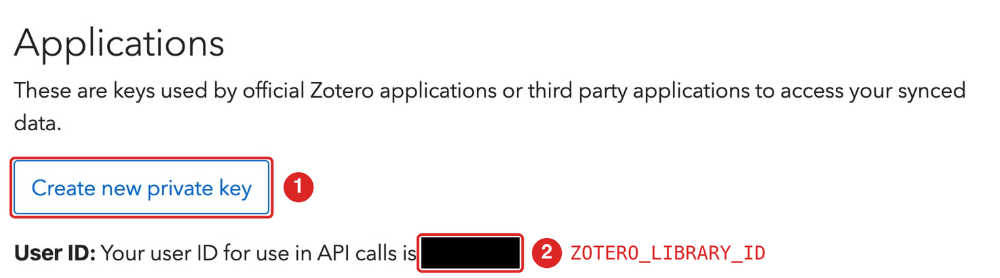
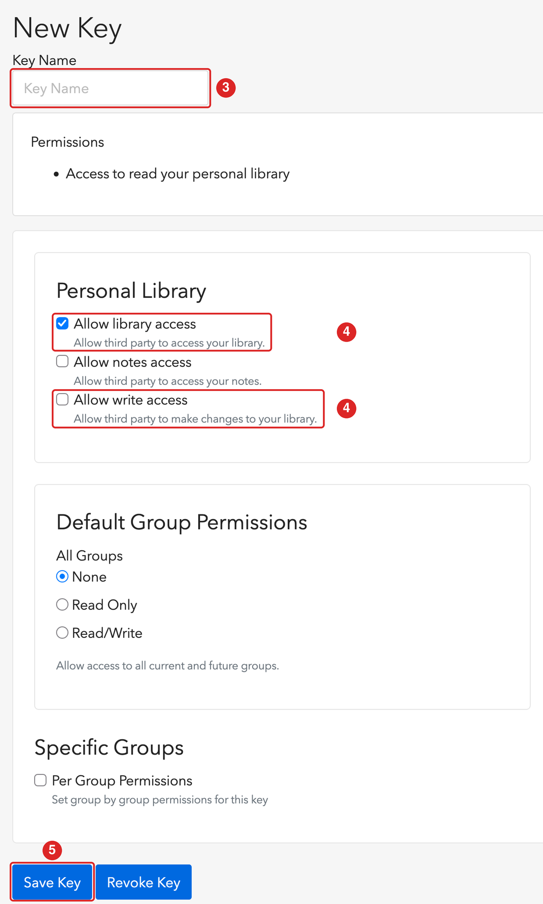

```{r, include = FALSE}
knitr::opts_chunk$set(collapse = TRUE, comment = "#>", eval = FALSE)
```

これは最初に一度だけ行うセットアップです。所要時間は 5 分ほどで、プロジェクトごとにやり直す必要はありません。次のことを行います。

1. Zotero の API キーを作成する
2. キーと Zotero のユーザー ID を R に教える
3. 引用したい項目すべてに引用キーがあることを確認する

このガイドのコードは、Zotero のアカウントが必要なため、サイトのビルド時には実行されません。

## 1. API キーを作成する

citezot は Zotero Web API と通信するため、API キーが必要です。Zotero デスクトップを起動しておく必要はありませんが、ライブラリが zotero.org と同期されている必要があります（Zotero デスクトップの*設定*→*同期*）。

1. <https://www.zotero.org/settings/keys> にサインインし、**Create new private key** を選びます。
2. **数字のユーザー ID** を控えます。同じページの「Your user ID for use in API calls is ...」という文に表示されています（ユーザー名ではありません）。

{fig-alt="Zotero のキーのページ。「Create new private key」ボタンに 1、ユーザー ID に 2 の印が付いている。" width=80%}

3. わかりやすい名前を付けます（例: `citezot-key`）。
4. *Personal library* の下で、**Allow library access**（「Allow third party to access your library」）にチェックを入れます。citezot を使うには必須です。citezot で Zotero の文献を読み取るだけでなく編集もしたい場合は、**Allow write access**（「Allow third party to make changes to your library」）にもチェックを入れます（[後述](#read-only-or-write-access)）。
5. キーを保存し、**今すぐコピーしてください**。Zotero がキーを表示するのは一度だけです。

{fig-alt="Zotero の新しいキーのフォーム。キー名に 3、ライブラリアクセスと書き込みアクセスのチェックボックスに 4、「Save Key」ボタンに 5 の印が付いている。" width=50%}

### 読み取り専用か、書き込み権限か {#read-only-or-write-access}

`cz_update_bib()`、`cz_find()`、`cz_get_item()`、`cz_fetch_items()` には、読み取り専用のキーで足ります。ライブラリを変更する関数（`cz_add()`、`cz_update_item()`、`cz_pin_key()`）だけが **Allow write access** を必要とします。これらの関数は `dry_run = FALSE` を渡さない限りドライランで、citezot には削除機能もありませんが、読み取り専用のキーは何が起きてもライブラリを変更できないため、技術的にはより安全です。書き込み権限は、あとで同じページからキーを編集して追加できます。

### グループライブラリ

グループライブラリの場合は、同じページの *Group permissions* でキーを作成します。グループ ID は、グループの URL（`https://www.zotero.org/groups/<ID>/<name>`）に含まれる数字です。そのうえで、`ZOTERO_LIBRARY_ID`（下記）にそのグループ ID を設定し、`cz_auth(library_type = "group")` を使います。

## 2. キーを R に教える

citezot は次の環境変数を読み取ります。

| 変数 | 内容 |
|---|---|
| `ZOTERO_API_KEY` | API キー |
| `ZOTERO_LIBRARY_ID` | 個人ライブラリ（ユーザー ID）またはグループライブラリの数字の ID |

これらは**ユーザーレベル**の `.Renviron` に保存してください。すべてのプロジェクトで使え、誤ってコミットしてしまうこともありません。`cz_set_auth()` を使えば、これを自動で行えます。ID とキーを尋ねられ（コマンド履歴に残りません）、ファイルに書き込み、現在のセッションですぐに使えるようになります。

```{r}
citezot::cz_set_auth()
```

自分でファイルを編集したい場合は、`usethis::edit_r_environ()` を実行して下の 2 行を追加し、保存してから **R を再起動**してください（`.Renviron` は起動時にしか読み込まれません）。

```
ZOTERO_API_KEY=xxxxxxxxxxxxxxxxxxxxxxxx
ZOTERO_LIBRARY_ID=1234567
```

どちらの方法でも、citezot が認証情報を認識できているか確認します。キーが表示されることはありません。

```{r}
library(citezot)
cz_auth()
#> <cz_auth> user library 1234567 (API key hidden)
```

キーをプロジェクト内のファイルに書かないでください。どうしても書く場合は、そのファイルを `.gitignore` に入れてください。

### citezot はキーをどう扱うか

* キーは `api.zotero.org` にのみ、ベアラートークンとして送信します。
* キーを表示、記録、保存することはありません。認証オブジェクトを `print()` してもキーは隠されます。
* 任意のキャッシュ（`cz_clear_cache()` を参照）に保存されるのは書誌情報のみで、キーは含まれません。

## 3. 項目に引用キーがあることを確認する

citezot は、項目に**保存された引用キー**で項目を引用します。キーのない項目は引用できず、`cz_update_bib()` は見つからなかったキーを知らせます。

項目にキーを付ける方法は 2 つあります。

### Better BibTeX を使う（推奨）

[Better BibTeX](https://retorque.re/zotero-better-bibtex/installation/) は、選んだ書式からキーを生成し、キーを*固定*して変わらないようにできます。固定されたキーは項目に保存され、citezot が読み取るのはそれです。Zotero デスクトップで項目を選択し、右クリックして *Better BibTeX*→*Pin BibTeX key* を選びます。その後同期すると、キーがアップロードされます。

Better BibTeX は必須ではありません。citezot がキーを読み取るのに必要ありません。

### Better BibTeX を使わない

Zotero は、各項目の **Citation Key** フィールドにキーを保存します。Zotero で手動で設定することも、R から設定することもできます。

```{r}
cz_find("darwin origin of species")             # 項目を探す
cz_pin_key("Darwin1859", "Darwin1859")          # プレビュー。item には cz_find() が解釈できる識別子を指定できます
cz_add("10.1016/0022-5193(64)90038-4", key = "auto")        # または、生成したキーで新しい項目を追加する
```

新しいキーの生成方法を含む一連の流れは、[論文執筆ガイド](manuscript.qmd)を参照してください。

## トラブルシューティング

* **「Zotero credentials not found.」** この R セッションで環境変数が設定されていません。`Sys.getenv("ZOTERO_API_KEY") != ""` を確認し、`.Renviron` を編集したら R を再起動してください。
* **HTTP 403。** キーが無効か、要求した権限がありません（たとえば、読み取り専用キーで項目を追加しようとした場合）。
* **存在するライブラリなのに HTTP 404。** ユーザー ID が間違っています。ユーザー名ではなく数字を使ってください。
* **Zotero デスクトップで追加したばかりの項目が見つからない。** ライブラリがまだ同期されていません。
