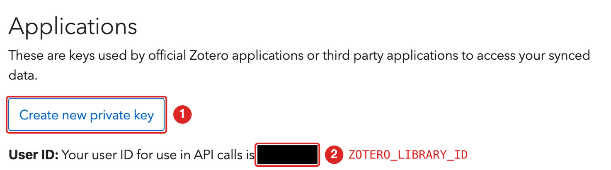
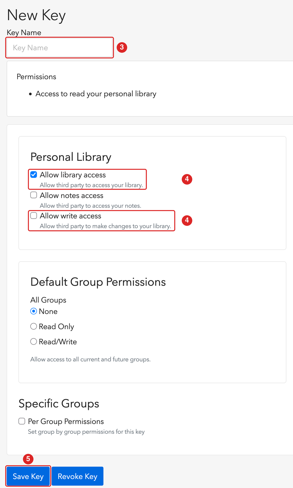

```{r, include = FALSE}
knitr::opts_chunk$set(collapse = TRUE, comment = "#>", eval = FALSE)
```

This is the one-time setup. It takes about five minutes, and you do not need to repeat it for each project. You need to:

1. create a Zotero API key,
2. tell R about the key and your Zotero user ID,
3. check that every item you want to cite has a citekey.

None of the code in this guide is run when the site is built, because it needs your Zotero account.

## 1. Create an API key

citezot talks to the Zotero web API, so it needs an API key. Zotero desktop does not have to be running, but your library must be synced to zotero.org (in Zotero desktop: *Settings*, *Sync*).

1. Sign in at <https://www.zotero.org/settings/keys> and choose **Create new private key**.
2. Note your **numeric user ID**. It is shown on the same page, in the sentence "Your user ID for use in API calls is ...". (It is *not* your user name.)

{fig-alt="The Zotero keys page, with the Create new private key button marked 1 and the user ID marked 2." width=80%}

3. Give it a name you will recognize, such as `citezot-key`.
4. Under *Personal library*, tick **Allow library access** ("Allow third party to access your library"). You need this to use citezot. If you also want to edit your Zotero references through citezot, not just read them, also tick **Allow write access** ("Allow third party to make changes to your library"); [see below](#read-only-or-write-access).
5. Save the key and **copy it now**. Zotero shows the key only once.

{fig-alt="The Zotero new key form, with the key name marked 3, the library access and write access checkboxes marked 4, and the Save Key button marked 5." width=50%}

### Read-only or write access {#read-only-or-write-access}

A read-only key is enough for `cz_update_bib()`, `cz_find()`, `cz_get_item()` and `cz_fetch_items()`. Only the functions that change your library (`cz_add()`, `cz_update_item()` and `cz_pin_key()`) need **Allow write access**. Those functions are dry runs unless you pass `dry_run = FALSE`, and citezot has no delete, but a read-only key is technically the safer choice, because it cannot change your library no matter what. You can edit the key on the same page later to add write access.

### Group libraries

For a group library, create the key under *Group permissions* on the same page. The group ID is the number in the group's URL (`https://www.zotero.org/groups/<ID>/<name>`). Then set `ZOTERO_LIBRARY_ID` (below) to that group ID and use `cz_auth(library_type = "group")`.

## 2. Tell R about the key

citezot reads these environment variables:

| Variable | What it holds |
|---|---|
| `ZOTERO_API_KEY` | the API key |
| `ZOTERO_LIBRARY_ID` | the numeric ID of your personal library (your user ID), or of a group library |

Save them to your **user-level** `.Renviron`, so they are available in every project and cannot be committed by accident. `cz_set_auth()` does this for you. It asks for the ID and key (so they never land in your command history), writes the file, and makes them available in the current session straight away:

```{r}
citezot::cz_set_auth()
```

Prefer to edit the file yourself? Run `usethis::edit_r_environ()`, add the two lines below, save, and **restart R** (`.Renviron` is read only at startup):

```
ZOTERO_API_KEY=xxxxxxxxxxxxxxxxxxxxxxxx
ZOTERO_LIBRARY_ID=1234567
```

Either way, check that citezot can see the credentials. The key is never printed:

```{r}
library(citezot)
cz_auth()
#> <cz_auth> user library 1234567 (API key hidden)
```

Do not put the key in a file inside a project. If you must, make sure the file is in `.gitignore`.

### What citezot does with your key

* It sends the key only to `api.zotero.org`, as a bearer token.
* It never prints, logs or stores it. `print()` on an auth object hides it.
* The optional cache (see `cz_clear_cache()`) holds bibliographic metadata, never the key.

## 3. Make sure your items have citekeys

citezot cites an item by the **citekey saved on it**. An item without one cannot be cited, and `cz_update_bib()` will tell you which keys it could not find.

There are two ways to get a key onto an item.

### With Better BibTeX (recommended)

[Better BibTeX](https://retorque.re/zotero-better-bibtex/installation/) generates keys from a formula you choose, and can *pin* them so they never change. Pinned keys are saved on the item, which is what citezot reads. In Zotero desktop, select the items, right-click, then *Better BibTeX* and *Pin BibTeX key*. Syncing then uploads the keys.

Better BibTeX is optional. citezot does not need it to read keys.

### Without Better BibTeX

Zotero stores the key in each item's **Citation Key** field. You can set it by hand in Zotero, or from R:

```{r}
cz_find("darwin origin of species")             # find the item
cz_pin_key("Darwin1859", "Darwin1859")          # preview; item = any of the identifiers cz_find() understands
cz_add("10.1016/0022-5193(64)90038-4", key = "auto")        # or add a new item with a generated key
```

See the [manuscript guide](manuscript.qmd) for the full workflow, including how new keys are generated.

## Troubleshooting

* **"Zotero credentials not found."** The variables are not set in this R session. Check `Sys.getenv("ZOTERO_API_KEY") != ""`, and restart R after editing `.Renviron`.
* **HTTP 403.** The key is invalid, or lacks the access you asked for (for example, a read-only key used to add an item).
* **HTTP 404 for a library that exists.** The user ID is wrong. Use the number, not the user name.
* **Items you just added in Zotero desktop are missing.** The library has not synced yet.
